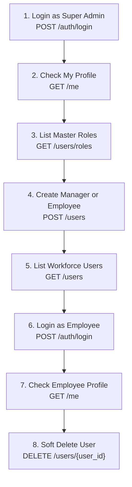

# GJ Spaces CRM - API Documentation

Comprehensive API documentation for the **GJ Spaces Centralized CRM Backend**, covering Authentication, Role-Based Access Control (RBAC), and Workforce Administration.

---

## 1. Overview & Setup

- **Base URL:** `http://localhost:8000`
- **Interactive Swagger UI:** [http://localhost:8000/docs](http://localhost:8000/docs)
- **ReDoc Documentation:** [http://localhost:8000/redoc](http://localhost:8000/redoc)
- **OpenAPI JSON Spec:** [http://localhost:8000/openapi.json](http://localhost:8000/openapi.json)

### Authentication Mechanism
Protected endpoints require a standard HTTP **Bearer Token** passed in the `Authorization` header:
```http
Authorization: Bearer <access_token>
```
The token is obtained via the `POST /auth/login` endpoint. It uses JSON Web Tokens (JWT) signed with HMAC-SHA256 (`HS256`) and has a default expiration of 120 minutes.

### Default Seeded Super Admin Credentials
On server startup, the database automatically initializes the default roles and seeds the initial Super Admin:
- **Email:** `ankita.patil@shakham.com`
- **Password:** `password1234`
- **Contact Number:** `+910000000000`

---

## 2. Roles & RBAC Matrix

| Role ID | Role Name | Description |
| :---: | :--- | :--- |
| **1** | `Super Admin` | Full root access across workforce, user creation, and soft-deletion. |
| **2** | `Manager` | Administrative access to view workforce users, roles, and profiles. Cannot create or delete users. |
| **3** | `Employee` | Standard workforce account. Can log in and view own profile (`/me`). |

### Permissions by Endpoint

| HTTP Method | Endpoint | Allowed Roles | Description |
| :--- | :--- | :--- | :--- |
| `GET` | `/` | Public | Root service info |
| `GET` | `/health` | Public | Container health check |
| `POST` | `/auth/login` | Public | Authenticate user credentials & receive JWT |
| `GET` | `/me` (or `/auth/me`) | Super Admin, Manager, Employee | Retrieve own profile (clean profile details) |
| `GET` | `/users/roles` | Super Admin, Manager | List master roles (`id` and `role_name` only) |
| `POST` | `/users` | Super Admin | Create Manager or Employee |
| `GET` | `/users` | Super Admin, Manager | List all workforce users (with filters) |
| `GET` | `/users/{user_id}` | Super Admin, Manager | Retrieve user details by UUID |
| `DELETE` | `/users/{user_id}` | Super Admin | Soft delete user |

---

## 3. Endpoints Specification

### 3.1 System & Health

---

#### `GET /`
Returns service status and documentation URLs.

- **Access:** Public
- **Headers:** None
- **Request Body:** None

**Response `200 OK`:**
```json
{
  "service": "GJ Spaces CRM API",
  "status": "online",
  "documentation": "/docs",
  "version": "1.0.0"
}
```

---

#### `GET /health`
Uptime health check endpoint.

- **Access:** Public
- **Headers:** None
- **Request Body:** None

**Response `200 OK`:**
```json
{
  "status": "healthy"
}
```

---

### 3.2 Authentication & Session (`/auth`, `/me`)

---

#### `POST /auth/login`
Authenticates a user using email or contact number and password. Returns signed JWT access token.

- **Access:** Public
- **Headers:** `Content-Type: application/json`
- **Request Body Schema:**
  - `email` (string, required): Registered user email or contact number.
  - `password` (string, required): Plaintext password.

**Sample Request Body:**
```json
{
  "email": "ankita.patil@shakham.com",
  "password": "password1234"
}
```
*(Also valid: `"email": "+910000000000"`)*

**Response `200 OK`:**
```json
{
  "message": "Authentication successful.",
  "access_token": "eyJhbGciOiJIUzI1NiIsInR5cCI6IkpXVCJ9..."
}
```

**Common Error Responses:**
- `401 Unauthorized`:
  ```json
  {
    "detail": "Incorrect email or password."
  }
  ```
- `403 Forbidden`:
  ```json
  {
    "detail": "Account is inactive. Please contact Super Admin."
  }
  ```

**cURL Example:**
```bash
curl -X POST "http://localhost:8000/auth/login" \
  -H "Content-Type: application/json" \
  -d '{
    "email": "ankita.patil@shakham.com",
    "password": "password1234"
  }'
```

---

#### `GET /me` (or `GET /auth/me`)
Retrieves the logged-in user's profile information. Both URLs (`/me` and `/auth/me`) are supported.

- **Access:** Any authenticated active user (`Super Admin`, `Manager`, `Employee`)
- **Headers:** 
  - `Authorization: Bearer <access_token>`
- **Request Body:** None

**Response `200 OK`:**
```json
{
  "role_name": "Super Admin",
  "first_name": "Super",
  "last_name": "Admin",
  "email": "ankita.patil@shakham.com",
  "contact_number": "+910000000000"
}
```

**Common Error Responses:**
- `401 Unauthorized`:
  ```json
  {
    "detail": "Could not validate credentials."
  }
  ```

**cURL Example:**
```bash
curl -X GET "http://localhost:8000/me" \
  -H "Authorization: Bearer <access_token>"
```

---

### 3.3 Workforce & User Administration (`/users`)

---

#### `GET /users/roles`
Retrieves available master roles for workforce assignment. Returns only `id` and `role_name`.

- **Access:** `Super Admin`, `Manager`
- **Headers:** 
  - `Authorization: Bearer <access_token>`
- **Request Body:** None

**Response `200 OK`:**
```json
[
  {
    "id": 1,
    "role_name": "Super Admin"
  },
  {
    "id": 2,
    "role_name": "Manager"
  },
  {
    "id": 3,
    "role_name": "Employee"
  }
]
```

**cURL Example:**
```bash
curl -X GET "http://localhost:8000/users/roles" \
  -H "Authorization: Bearer <access_token>"
```

---

#### `POST /users`
Super Admin endpoint to create new Managers or Employees.
- `status` defaults to `"active"` automatically.
- `role_id` defaults to `3` (`Employee`) if omitted, or you can specify `2` for `Manager`.
- You can alternatively provide `"role_name": "Manager"` instead of `role_id`.

- **Access:** `Super Admin` only
- **Headers:** 
  - `Content-Type: application/json`
  - `Authorization: Bearer <access_token>`
- **Request Body Fields:**
  - `first_name` (string, required): User's first name.
  - `last_name` (string, optional): User's last name.
  - `email` (string, required): Unique email address.
  - `contact_number` (string, required): Unique contact phone number.
  - `password` (string, required, min 6 chars): Password.
  - `role_id` (integer, optional, default: `3`): `2` for Manager, `3` for Employee.
  - `role_name` (string, optional): Alternatively pass `"Manager"` or `"Employee"`.
  - `status` (string, optional, default: `"active"`): Defaults to `"active"`.

**Sample Request Body (Creating a Manager):**
```json
{
  "first_name": "Rajesh",
  "last_name": "Kumar",
  "email": "rajesh.kumar@gjspaces.com",
  "contact_number": "+919876543210",
  "password": "SecurePassword123!",
  "role_id": 2
}
```

**Sample Request Body (Creating an Employee - minimal):**
```json
{
  "first_name": "Priya",
  "last_name": "Sharma",
  "email": "priya.sharma@gjspaces.com",
  "contact_number": "+919876543211",
  "password": "SecurePassword123!"
}
```
*(Automatically assigns `role_name`: "Employee" and `status`: "active")*

**Response `201 Created`:**
```json
{
  "id": "7b0a7082-f54e-4e31-8bc4-72945d8b8a01",
  "first_name": "Rajesh",
  "last_name": "Kumar",
  "email": "rajesh.kumar@gjspaces.com",
  "contact_number": "+919876543210",
  "role_name": "Manager",
  "status": "active"
}
```

**Common Error Responses:**
- `400 Bad Request` (Invalid role):
  ```json
  {
    "detail": "Role with ID '99' does not exist."
  }
  ```
- `403 Forbidden` (Attempting to create another Super Admin):
  ```json
  {
    "detail": "Secondary Super Admin users cannot be created via this endpoint."
  }
  ```
- `409 Conflict` (Email or Contact already in use):
  ```json
  {
    "detail": "Email 'rajesh.kumar@gjspaces.com' is already registered."
  }
  ```

**cURL Example:**
```bash
curl -X POST "http://localhost:8000/users" \
  -H "Content-Type: application/json" \
  -H "Authorization: Bearer <access_token>" \
  -d '{
    "first_name": "Rajesh",
    "last_name": "Kumar",
    "email": "rajesh.kumar@gjspaces.com",
    "contact_number": "+919876543210",
    "password": "SecurePassword123!",
    "role_id": 2
  }'
```

---

#### `GET /users`
Lists active workforce users.

- **Access:** `Super Admin`, `Manager`
- **Headers:** 
  - `Authorization: Bearer <access_token>`
- **Query Parameters (Optional):**
  - `role_id` (integer): Filter by Role ID (`?role_id=2` or `?role_id=3`)
  - `status` (string): Filter by user status (`?status=active`)
- **Request Body:** None

**Response `200 OK`:**
```json
[
  {
    "id": "7b0a7082-f54e-4e31-8bc4-72945d8b8a01",
    "first_name": "Rajesh",
    "last_name": "Kumar",
    "email": "rajesh.kumar@gjspaces.com",
    "contact_number": "+919876543210",
    "role_name": "Manager",
    "status": "active"
  }
]
```

**cURL Example:**
```bash
curl -X GET "http://localhost:8000/users" \
  -H "Authorization: Bearer <access_token>"
```

---

#### `GET /users/{user_id}`
Retrieves a single user's profile and assigned role by UUID.

- **Access:** `Super Admin`, `Manager`
- **Headers:** 
  - `Authorization: Bearer <access_token>`
- **Path Parameters:**
  - `user_id` (UUID string, required)
- **Request Body:** None

**Response `200 OK`:**
```json
{
  "id": "7b0a7082-f54e-4e31-8bc4-72945d8b8a01",
  "first_name": "Rajesh",
  "last_name": "Kumar",
  "email": "rajesh.kumar@gjspaces.com",
  "contact_number": "+919876543210",
  "role_name": "Manager",
  "status": "active"
}
```

**cURL Example:**
```bash
curl -X GET "http://localhost:8000/users/7b0a7082-f54e-4e31-8bc4-72945d8b8a01" \
  -H "Authorization: Bearer <access_token>"
```

---

#### `DELETE /users/{user_id}`
Soft deletes a user record (sets `is_deleted = true`, `status = 'inactive'`).

- **Access:** `Super Admin` only
- **Headers:** 
  - `Authorization: Bearer <access_token>`
- **Path Parameters:**
  - `user_id` (UUID string, required)
- **Request Body:** None

**Response `200 OK`:**
```json
{
  "message": "User 'Rajesh Kumar' soft-deleted successfully.",
  "user_id": "7b0a7082-f54e-4e31-8bc4-72945d8b8a01"
}
```

**cURL Example:**
```bash
curl -X DELETE "http://localhost:8000/users/7b0a7082-f54e-4e31-8bc4-72945d8b8a01" \
  -H "Authorization: Bearer <access_token>"
```

---

## 4. End-to-End Testing Workflow



### 1. Login as Super Admin
```bash
curl -s -X POST "http://localhost:8000/auth/login" \
  -H "Content-Type: application/json" \
  -d '{"email": "ankita.patil@shakham.com", "password": "password1234"}'
```

### 2. Verify Profile (`/me`)
```bash
curl -s -X GET "http://localhost:8000/me" \
  -H "Authorization: Bearer <TOKEN>"
```

### 3. Check Available Roles
```bash
curl -s -X GET "http://localhost:8000/users/roles" \
  -H "Authorization: Bearer <TOKEN>"
```

### 4. Create an Employee
`status` automatically defaults to `"active"`, and omitting `role_id` defaults to `3` (`Employee`):
```bash
curl -s -X POST "http://localhost:8000/users" \
  -H "Content-Type: application/json" \
  -H "Authorization: Bearer <TOKEN>" \
  -d '{
    "first_name": "Priya",
    "last_name": "Sharma",
    "email": "priya.sharma@gjspaces.com",
    "contact_number": "+919999888877",
    "password": "Password123!"
  }'
```

### 5. Soft Delete User
```bash
curl -s -X DELETE "http://localhost:8000/users/<USER_ID>" \
  -H "Authorization: Bearer <TOKEN>"
```
