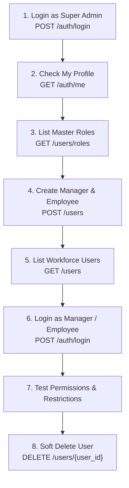

# GJ Spaces CRM - API Documentation

Comprehensive API documentation for the **GJ Spaces Centralized CRM Backend**, covering Authentication, Role-Based Access Control (RBAC), and Workforce Administration.

---

## 1. Overview & Setup

- **Base URL:** `http://localhost:8000`
- **Interactive Swagger UI:** [http://localhost:8000/docs](http://localhost:8000/docs)
- **ReDoc Documentation:** [http://localhost:8000/redoc](http://localhost:8000/redoc)
- **OpenAPI JSON Spec:** [http://localhost:8000/openapi.json](http://localhost:8000/openapi.json)

### Authentication Mechanism
Protected endpoints require a standard HTTP **Bearer Token** passed in the `Authorization` header:
```http
Authorization: Bearer <access_token>
```
The token is obtained via the `POST /auth/login` endpoint. It uses JSON Web Tokens (JWT) signed with HMAC-SHA256 (`HS256`) and has a default expiration of 120 minutes.

### Default Seeded Super Admin Credentials
On server startup, the database automatically initializes the default roles and seeds the initial Super Admin:
- **Email:** `admin@gjspaces.com`
- **Password:** `password1234`
- **Contact Number:** `+910000000000`

---

## 2. Standard Response Format

All workforce and profile endpoints wrap response data inside a standard **Response Envelope**:

### Successful Response Format
```json
{
  "success": true,
  "statusCode": 200,
  "message": "Operation completed successfully.",
  "data": { ... },
  "meta": null
}
```

### Error Response Format
```json
{
  "detail": "Descriptive error message"
}
```

---

## 3. Roles & RBAC Matrix

| Role ID | Role Name | Description |
| :---: | :--- | :--- |
| **1** | `Super Admin` | Full root access across workforce, user creation, and soft-deletion. |
| **2** | `Manager` | Administrative access to view workforce users, roles, and profiles. Cannot create or delete users. |
| **3** | `Employee` | Standard workforce account. Can log in and view own profile (`/auth/me`). |

### Permissions by Endpoint

| HTTP Method | Endpoint | Allowed Roles | Description |
| :--- | :--- | :--- | :--- |
| `GET` | `/` | Public | Root service info |
| `GET` | `/health` | Public | Container health check |
| `POST` | `/auth/login` | Public | Authenticate user credentials & receive JWT |
| `GET` | `/auth/me` | Super Admin, Manager, Employee | Retrieve own profile |
| `GET` | `/users/roles` | Super Admin, Manager | List master roles |
| `POST` | `/users` | Super Admin | Create Manager or Employee |
| `GET` | `/users` | Super Admin, Manager | List all workforce users (with filters) |
| `GET` | `/users/{user_id}` | Super Admin, Manager | Retrieve user details by UUID |
| `DELETE` | `/users/{user_id}` | Super Admin | Soft delete user |

---

## 4. Endpoints Specification

### 4.1 System & Health

---

#### `GET /`
Returns service status and documentation URLs.

- **Access:** Public
- **Headers:** None
- **Query / Path Parameters:** None
- **Request Body:** None

**Response `200 OK`:**
```json
{
  "service": "GJ Spaces CRM API",
  "status": "online",
  "documentation": "/docs",
  "version": "1.0.0"
}
```

---

#### `GET /health`
Uptime health check endpoint.

- **Access:** Public
- **Headers:** None
- **Request Body:** None

**Response `200 OK`:**
```json
{
  "status": "healthy"
}
```

---

### 4.2 Authentication & Session (`/auth`)

---

#### `POST /auth/login`
Authenticates a user using email or contact number and password. Returns signed JWT access token.

- **Access:** Public
- **Headers:** `Content-Type: application/json`
- **Request Body Schema:**
  - `email` (string, required): Registered user email or contact number.
  - `password` (string, required): Plaintext password.

**Sample Request Body:**
```json
{
  "email": "admin@gjspaces.com",
  "password": "password1234"
}
```
*(Also valid: `"email": "+910000000000"`)*

**Response `200 OK`:**
```json
{
  "message": "Authentication successful.",
  "access_token": "eyJhbGciOiJIUzI1NiIsInR5cCI6IkpXVCJ9.eyJleHAiOjE3NjM0MzA3MzQsInN1YiI6IjBhODRkZTBmLTk4MmUtNDdiMC04ODBiLWJkODBlNTVkM2RlNiIsInR5cGUiOiJhY2Nlc3MifQ..."
}
```

**Common Error Responses:**
- `401 Unauthorized`:
  ```json
  {
    "detail": "Incorrect email or password."
  }
  ```
- `403 Forbidden`:
  ```json
  {
    "detail": "Account is inactive. Please contact Super Admin."
  }
  ```

**cURL Example:**
```bash
curl -X POST "http://localhost:8000/auth/login" \
  -H "Content-Type: application/json" \
  -d '{
    "email": "admin@gjspaces.com",
    "password": "password1234"
  }'
```

---

#### `GET /auth/me`
Retrieves the authenticated user's profile and assigned role.

- **Access:** Any authenticated active user (`Super Admin`, `Manager`, `Employee`)
- **Headers:** 
  - `Authorization: Bearer <access_token>`
- **Request Body:** None

**Response `200 OK`:**
```json
{
  "success": true,
  "statusCode": 200,
  "message": "Operation completed successfully.",
  "data": {
    "id": "0a84de0f-982e-47b0-880b-bd80e55d3de6",
    "role_id": 1,
    "role_name": "Super Admin",
    "first_name": "Super",
    "last_name": "Admin",
    "email": "admin@gjspaces.com",
    "contact_number": "+910000000000",
    "status": "active",
    "created_at": "2026-11-17T03:55:00.123456Z",
    "updated_at": "2026-11-17T03:55:00.123456Z",
    "is_deleted": false
  },
  "meta": null
}
```

**Common Error Responses:**
- `401 Unauthorized`:
  ```json
  {
    "detail": "Could not validate credentials."
  }
  ```

**cURL Example:**
```bash
curl -X GET "http://localhost:8000/auth/me" \
  -H "Authorization: Bearer <access_token>"
```

---

### 4.3 Workforce & User Administration (`/users`)

---

#### `GET /users/roles`
Retrieves available master roles for workforce assignment.

- **Access:** `Super Admin`, `Manager`
- **Headers:** 
  - `Authorization: Bearer <access_token>`
- **Request Body:** None

**Response `200 OK`:**
```json
{
  "success": true,
  "statusCode": 200,
  "message": "Operation completed successfully.",
  "data": [
    {
      "id": 1,
      "role_name": "Super Admin",
      "created_at": "2026-11-17T03:55:00.000000Z",
      "updated_at": "2026-11-17T03:55:00.000000Z",
      "is_deleted": false
    },
    {
      "id": 2,
      "role_name": "Manager",
      "created_at": "2026-11-17T03:55:00.000000Z",
      "updated_at": "2026-11-17T03:55:00.000000Z",
      "is_deleted": false
    },
    {
      "id": 3,
      "role_name": "Employee",
      "created_at": "2026-11-17T03:55:00.000000Z",
      "updated_at": "2026-11-17T03:55:00.000000Z",
      "is_deleted": false
    }
  ],
  "meta": null
}
```

**cURL Example:**
```bash
curl -X GET "http://localhost:8000/users/roles" \
  -H "Authorization: Bearer <access_token>"
```

---

#### `POST /users`
Super Admin endpoint to create new Managers or Employees.

- **Access:** `Super Admin` only
- **Headers:** 
  - `Content-Type: application/json`
  - `Authorization: Bearer <access_token>`
- **Request Body Fields:**
  - `first_name` (string, required, 1-100 chars): User's first name.
  - `last_name` (string, optional, max 100 chars): User's last name.
  - `email` (string, required, valid email): Unique email address.
  - `contact_number` (string, required, 10-20 chars): Unique contact phone number.
  - `password` (string, required, min 6 chars): Raw password (bcrypt hashed on storage).
  - `role_id` (integer, required): Target role ID (`2` for Manager, `3` for Employee).
  - `status` (string, optional, default `"active"`): Account status (`"active"` or `"inactive"`).

**Sample Request Body (Create a Manager):**
```json
{
  "first_name": "Rajesh",
  "last_name": "Kumar",
  "email": "rajesh.kumar@gjspaces.com",
  "contact_number": "+919876543210",
  "password": "SecurePassword123!",
  "role_id": 2,
  "status": "active"
}
```

**Sample Request Body (Create an Employee):**
```json
{
  "first_name": "Priya",
  "last_name": "Sharma",
  "email": "priya.sharma@gjspaces.com",
  "contact_number": "+919876543211",
  "password": "SecurePassword123!",
  "role_id": 3,
  "status": "active"
}
```

**Response `201 Created`:**
```json
{
  "success": true,
  "statusCode": 201,
  "message": "Manager 'Rajesh Kumar' created successfully.",
  "data": {
    "id": "7b0a7082-f54e-4e31-8bc4-72945d8b8a01",
    "role_id": 2,
    "role_name": "Manager",
    "first_name": "Rajesh",
    "last_name": "Kumar",
    "email": "rajesh.kumar@gjspaces.com",
    "contact_number": "+919876543210",
    "status": "active",
    "created_at": "2026-11-17T09:30:15.000000Z",
    "updated_at": "2026-11-17T09:30:15.000000Z",
    "is_deleted": false
  },
  "meta": null
}
```

**Common Error Responses:**
- `400 Bad Request`:
  ```json
  {
    "detail": "Role with ID '99' does not exist."
  }
  ```
- `403 Forbidden` (Trying to create another Super Admin):
  ```json
  {
    "detail": "Secondary Super Admin users cannot be created via this endpoint."
  }
  ```
- `409 Conflict` (Email or Contact already in use):
  ```json
  {
    "detail": "Email 'rajesh.kumar@gjspaces.com' is already registered."
  }
  ```
- `422 Unprocessable Entity` (Validation failure - short password or invalid email):
  ```json
  {
    "detail": [
      {
        "loc": ["body", "email"],
        "msg": "value is not a valid email address",
        "type": "value_error"
      }
    ]
  }
  ```

**cURL Example:**
```bash
curl -X POST "http://localhost:8000/users" \
  -H "Content-Type: application/json" \
  -H "Authorization: Bearer <access_token>" \
  -d '{
    "first_name": "Rajesh",
    "last_name": "Kumar",
    "email": "rajesh.kumar@gjspaces.com",
    "contact_number": "+919876543210",
    "password": "SecurePassword123!",
    "role_id": 2,
    "status": "active"
  }'
```

---

#### `GET /users`
Lists active workforce users. Allows optional query filtering.

- **Access:** `Super Admin`, `Manager`
- **Headers:** 
  - `Authorization: Bearer <access_token>`
- **Query Parameters (All Optional):**
  - `role_id` (integer): Filter by Role ID (e.g. `?role_id=2`)
  - `status` (string): Filter by user status (e.g. `?status=active` or `?status=inactive`)
- **Request Body:** None

**Example URL with filters:**
`GET http://localhost:8000/users?role_id=2&status=active`

**Response `200 OK`:**
```json
{
  "success": true,
  "statusCode": 200,
  "message": "Operation completed successfully.",
  "data": [
    {
      "id": "7b0a7082-f54e-4e31-8bc4-72945d8b8a01",
      "role_id": 2,
      "role_name": "Manager",
      "first_name": "Rajesh",
      "last_name": "Kumar",
      "email": "rajesh.kumar@gjspaces.com",
      "contact_number": "+919876543210",
      "status": "active",
      "created_at": "2026-11-17T09:30:15.000000Z",
      "updated_at": "2026-11-17T09:30:15.000000Z",
      "is_deleted": false
    }
  ],
  "meta": null
}
```

**cURL Example:**
```bash
curl -X GET "http://localhost:8000/users?role_id=2&status=active" \
  -H "Authorization: Bearer <access_token>"
```

---

#### `GET /users/{user_id}`
Retrieves a single user's profile and assigned role by their UUID.

- **Access:** `Super Admin`, `Manager`
- **Headers:** 
  - `Authorization: Bearer <access_token>`
- **Path Parameters:**
  - `user_id` (UUID string, required): Unique identifier of the user.
- **Request Body:** None

**Response `200 OK`:**
```json
{
  "success": true,
  "statusCode": 200,
  "message": "Operation completed successfully.",
  "data": {
    "id": "7b0a7082-f54e-4e31-8bc4-72945d8b8a01",
    "role_id": 2,
    "role_name": "Manager",
    "first_name": "Rajesh",
    "last_name": "Kumar",
    "email": "rajesh.kumar@gjspaces.com",
    "contact_number": "+919876543210",
    "status": "active",
    "created_at": "2026-11-17T09:30:15.000000Z",
    "updated_at": "2026-11-17T09:30:15.000000Z",
    "is_deleted": false
  },
  "meta": null
}
```

**Common Error Responses:**
- `404 Not Found`:
  ```json
  {
    "detail": "User with ID '7b0a7082-f54e-4e31-8bc4-72945d8b8a01' was not found."
  }
  ```

**cURL Example:**
```bash
curl -X GET "http://localhost:8000/users/7b0a7082-f54e-4e31-8bc4-72945d8b8a01" \
  -H "Authorization: Bearer <access_token>"
```

---

#### `DELETE /users/{user_id}`
Soft deletes a user record (sets `is_deleted = true`, `deleted_at = now()`, and `status = 'inactive'`).

- **Access:** `Super Admin` only
- **Headers:** 
  - `Authorization: Bearer <access_token>`
- **Path Parameters:**
  - `user_id` (UUID string, required): Unique identifier of the user to soft-delete.
- **Request Body:** None

**Response `200 OK`:**
```json
{
  "success": true,
  "statusCode": 200,
  "message": "User 'Rajesh Kumar' has been soft-deleted successfully.",
  "data": {
    "user_id": "7b0a7082-f54e-4e31-8bc4-72945d8b8a01",
    "is_deleted": true
  },
  "meta": null
}
```

**Common Error Responses:**
- `400 Bad Request` (Attempting to self-delete Super Admin account):
  ```json
  {
    "detail": "Super Admin cannot delete their own account."
  }
  ```
- `403 Forbidden` (Called by Manager or Employee):
  ```json
  {
    "detail": "Operation not permitted. Required roles: ['Super Admin']"
  }
  ```
- `404 Not Found`:
  ```json
  {
    "detail": "User with ID '7b0a7082-f54e-4e31-8bc4-72945d8b8a01' was not found or already deleted."
  }
  ```

**cURL Example:**
```bash
curl -X DELETE "http://localhost:8000/users/7b0a7082-f54e-4e31-8bc4-72945d8b8a01" \
  -H "Authorization: Bearer <access_token>"
```

---

## 5. End-to-End Testing Workflow

Here is the recommended step-by-step procedure to test the entire API lifecycle:



### 1. Login as Super Admin
Send credentials to `/auth/login`:
```bash
curl -s -X POST "http://localhost:8000/auth/login" \
  -H "Content-Type: application/json" \
  -d '{"email": "admin@gjspaces.com", "password": "password1234"}'
```
*Save the `access_token` from the response.*

### 2. Verify Session
Verify that the token works and identifies you as Super Admin:
```bash
curl -s -X GET "http://localhost:8000/auth/me" \
  -H "Authorization: Bearer <TOKEN>"
```

### 3. Check Available Roles
Ensure roles are seeded:
```bash
curl -s -X GET "http://localhost:8000/users/roles" \
  -H "Authorization: Bearer <TOKEN>"
```
*(Confirms `id: 1` = Super Admin, `id: 2` = Manager, `id: 3` = Employee)*

### 4. Create an Employee
Create a test employee user:
```bash
curl -s -X POST "http://localhost:8000/users" \
  -H "Content-Type: application/json" \
  -H "Authorization: Bearer <TOKEN>" \
  -d '{
    "first_name": "Test",
    "last_name": "Employee",
    "email": "employee@gjspaces.com",
    "contact_number": "+919999888877",
    "password": "Password123!",
    "role_id": 3,
    "status": "active"
  }'
```

### 5. Verify In Users List
List all active employees:
```bash
curl -s -X GET "http://localhost:8000/users?role_id=3" \
  -H "Authorization: Bearer <TOKEN>"
```

### 6. Test RBAC Restriction
Log in as the new employee (`employee@gjspaces.com` / `Password123!`), obtain the employee's JWT, and attempt to delete a user:
```bash
curl -s -X DELETE "http://localhost:8000/users/<USER_ID>" \
  -H "Authorization: Bearer <EMPLOYEE_TOKEN>"
```
*Response will return `403 Forbidden` (`"Operation not permitted. Required roles: ['Super Admin']"`).*

### 7. Soft Delete User
Using the Super Admin token, delete the user:
```bash
curl -s -X DELETE "http://localhost:8000/users/<USER_ID>" \
  -H "Authorization: Bearer <SUPER_ADMIN_TOKEN>"
```
*The user is now marked as `is_deleted = true`, `status = "inactive"`, and will no longer appear in `/users` or be able to log in.*
